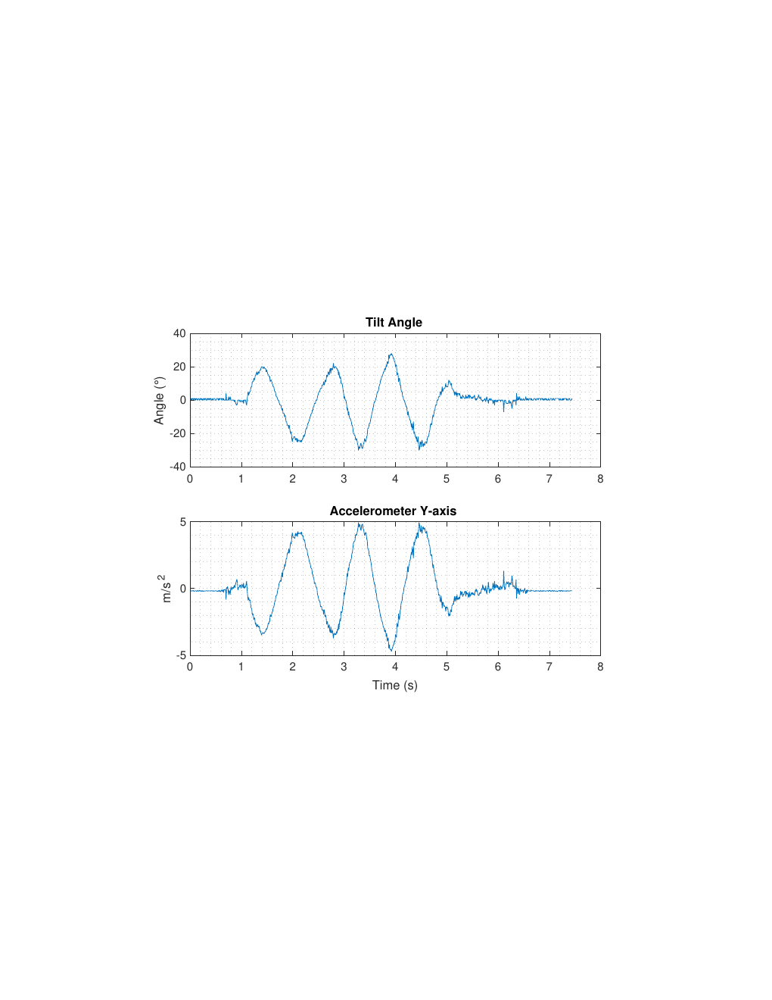
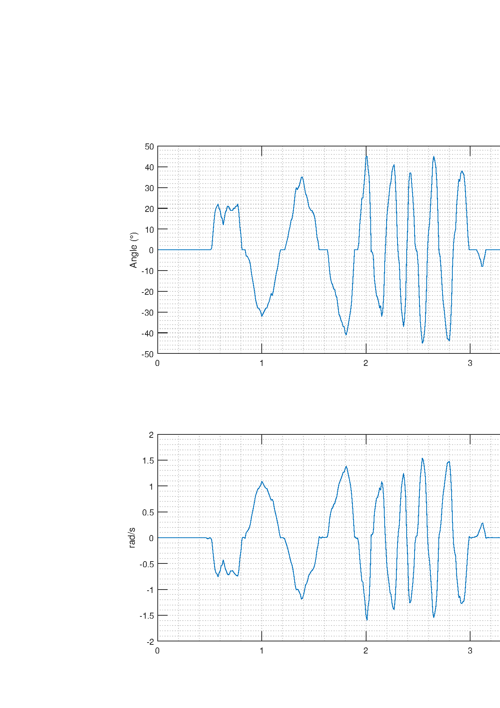
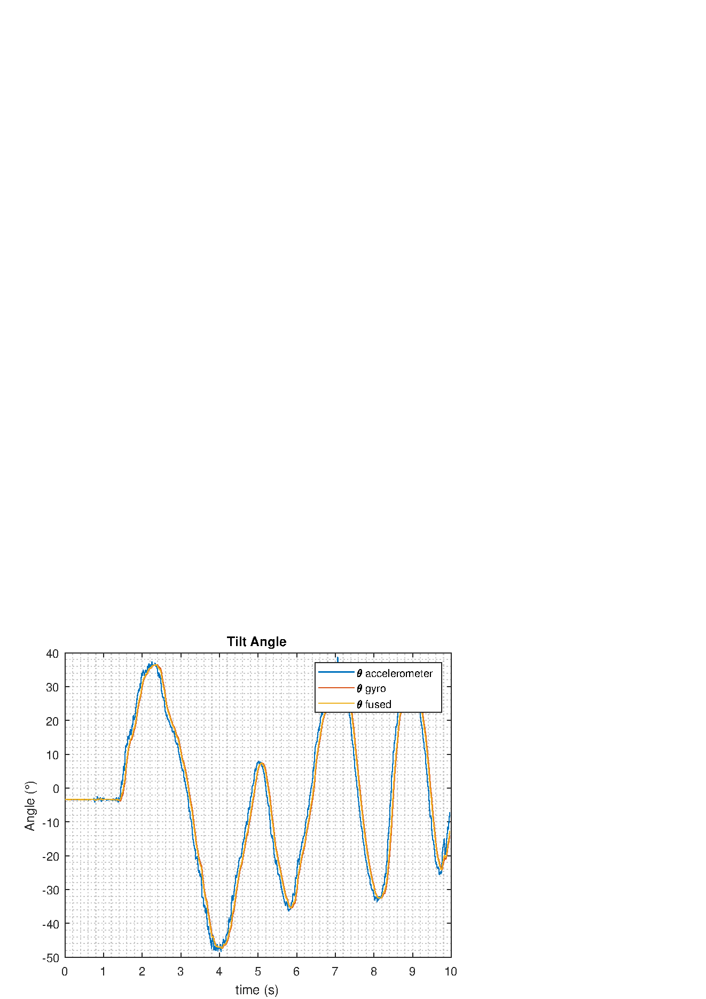

# IMU-Based Camera Stabilisation — Tilt and Pan Control

Embedded Real-Time Control laboratory (Lab 2) — M.Sc. Control Systems Engineering, University of Padova,
course held by Prof. Alberto Morato. Platform: the course's **T-Bot** (STM32F767, bare-metal C), with a **BNO055**
IMU on I²C and two PWM servos moving a camera mount.

**One-page overview (PDF): [`docs/project-overview.pdf`](docs/project-overview.pdf)** ·
**Submitted report (PDF, LaTeX source included): [`report/Embedded-Report-lab2.pdf`](report/Embedded-Report-lab2.pdf)**

---

## Purpose of the lab

Implement **open-loop control** on the robot: use the inertial measurement unit to keep a camera level (tilt) and to
drive its pan axis, then improve the result with two bonus tasks.

## What I implemented

### Exercise 1 — tilt stabilisation from the accelerometer

The tilt angle is estimated from the measured Y acceleration and the camera command is its negative, clamped to ±45°:

```c
// Read the y acceleration data
y_accelerate = d_accel_xyz.y;

// calculate tilt angle
float g = 9.81; // m/s^2
tilt = asin(y_accelerate / g) * (180 / M_PI); // convert to degrees
camera_tilt = -tilt;

// limit the tilt to 45 to -45
if(camera_tilt > 45) camera_tilt = 45;
if(camera_tilt < -45) camera_tilt = -45;
```

### Bonus 1 — smooth pan control from the gyroscope

The pan axis uses a pure proportional law on the Z-axis angular rate (gain tuned during the lab):

```c
// read the z axis gyroscope value
z_gyro = d_gyro_xyz.z;

// calculate pan control signal using proportional control
pan = -kp * z_gyro;          // kp = 30

// limit the pan to 45 to -45
if(pan > 45) pan = 45;
if(pan < -45) pan = -45;
```

### Actuator mapping

Both angles are mapped to servo duty counts around the mechanical centre and passed through a `saturate()` function
that enforces the servo limits, so the mount is never driven against its end stops:

```c
__HAL_TIM_SET_COMPARE(&htim1, TIM_CHANNEL_3,
        (uint32_t)saturate((150 + pan * (50.0/45.0)), SERVO_MIN_VALUE, SERVO_MAX_VALUE));          // tilt
__HAL_TIM_SET_COMPARE(&htim1, TIM_CHANNEL_2,
        (uint32_t)saturate((150 + camera_tilt * (50.0/45.0)), SERVO_MIN_VALUE, SERVO_MAX_VALUE));    // pan
```

### Telemetry and Bonus 2

I restructured the datalogger record to carry the signals that actually matter for analysis
(`tilt_angle`, `y_accelerate`, `pan_control`, `z_gyro`) and fixed the order of the logger update/send calls so the
transmitted packets are complete; data was acquired with the MATLAB serial/WiFi datalogger. **Bonus 2** combines
accelerometer and gyroscope information (sensor fusion) for a more stable tilt/pan response.

## Results

| Exercise 1 — tilt stabilisation | Bonus 1 — gyro-based pan |
|---|---|
|  |  |



The tilt loop holds the camera level for moderate platform inclination, and the gyro-based pan follows the rotation
rate far more smoothly than the accelerometer-only solution. The report documents the control laws, the clamping
strategy and the measurement results.

## Repository contents

| Path | Content |
|---|---|
| `report/Embedded-Report-lab2.pdf` | My submitted Lab 2 report (with the LaTeX source and figures) |
| `report/report.tex`, `report/figures/` | LaTeX source of the combined Lab 1 + Lab 2 report and all figures (measured outputs, photos) |
| `src/user_code_main.c` | The `USER CODE` sections of the `main.c` I submitted — tilt/pan control laws, actuator mapping, telemetry record |
| `docs/project-overview.pdf` | One-page English overview of the lab |

> **Scope note:** `src/user_code_main.c` collects only the CubeMX `USER CODE` sections of my submitted file. The
> surrounding project — the course's T-Bot framework, the STM32 HAL and the Bosch BNO055 driver — is course/vendor
> material and is deliberately **not** redistributed; read the file together with the report.

## Skills demonstrated

`IMU integration over I²C (BNO055)` · `inclinometer estimation from accelerometer data` · `proportional control
design and gain tuning` · `accelerometer/gyroscope sensor fusion` · `PWM servo actuation with saturation handling` ·
`fixed-rate real-time control loops` · `data logging and analysis with MATLAB` · `bare-metal C on ARM Cortex-M` ·
`technical reporting in LaTeX`

## Licence

Code and text are mine, released under the [MIT licence](LICENSE); the report is © Kiavash Rabbani Soudabi.
